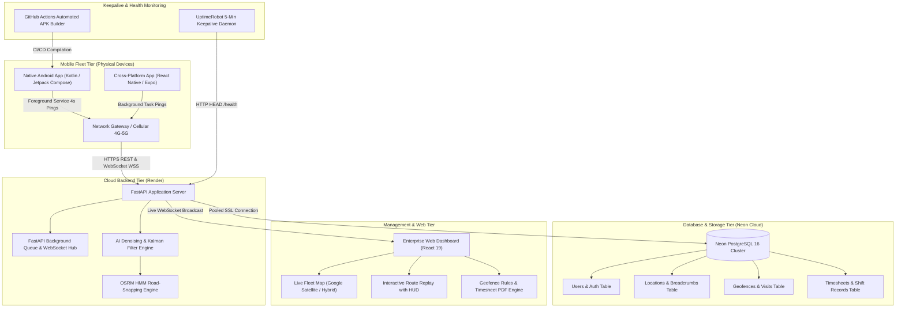
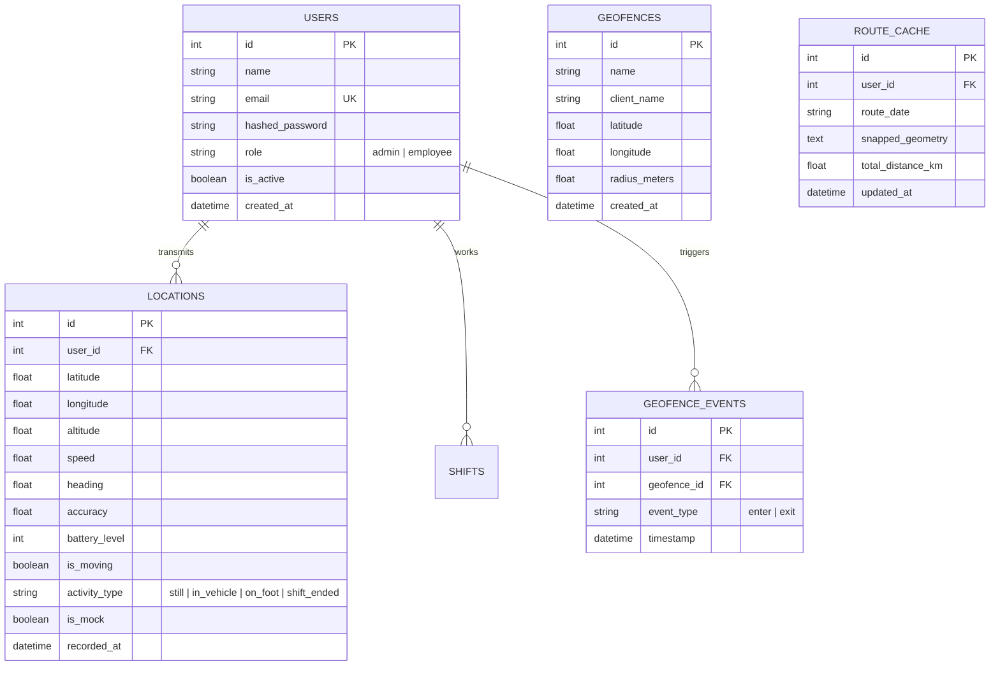

# GeoTrack Enterprise Fleet & Workforce Tracking System
## Official Project Handover & Technical Specification Document
**Version:** 2.0.0 (Production Release)  
**Date:** November 26, 2026  
**Document Classification:** Confidential — Enterprise Proprietary  
**Prepared For:** Executive Operations & IT Management  

---

## 1. Executive Project Summary

| Parameter | Specification |
| :--- | :--- |
| **Project Name** | GeoTrack Enterprise Fleet & Mobile Workforce Tracking System |
| **Primary Objective** | Real-time GPS fleet telemetry, automated shift date-binding, road-snapped playback, geofence compliance, and automated timesheets |
| **Backend Engine** | Python 3.10+ / FastAPI / SQLAlchemy / WebSockets |
| **Database Tier** | Neon Serverless PostgreSQL 16 (Connection Pooled via AWS US-East-2) |
| **Web Dashboard** | React 19 / Vite / TailwindCSS / Leaflet / Zustand |
| **Mobile Platforms** | 1. Native Android (Kotlin / Jetpack Compose / Foreground Location Service)<br>2. React Native (Cross-Platform Mobile App) |
| **Routing / Snapping Engine** | Open Source Routing Machine (OSRM) with Dual-Host Self-Hosted Fallback |
| **Current Operational Status** | **Production Deployed & Live (Stable)** |

---

## 2. Pre-Project Phase: Architecture & Requirements

Before system development commenced, the technical and business requirements were established as follows:

### 2.1 Business Requirements Document (BRD) Highlights
1. **Zero Data Loss in Field Conditions:** Drivers frequently enter mobile dead zones (cell-tower shadows, basements, highway gaps). The mobile client must maintain an encrypted SQLite local cache and synchronize automatically upon signal reconnection.
2. **Zero Battery Drain / High Efficiency:** Adaptive GPS sampling that drops to power-saving mode when stationary and scales to 4-second high-precision updates when in transit (> 15 km/h).
3. **Strict Date-Bound Shift Tracking:** Shifts must never cross overnight boundaries into a new calendar day. If a driver forgets to end a shift, the system automatically terminates tracking at 00:00 IST to prevent phantom mileage.
4. **Clean Road-Snapped Replay:** GPS telemetry must snap to real road networks using Hidden Markov Models (HMM) without erratic building-crossing jumps or artificial block-circling detours.

### 2.2 System Architecture Diagram



---

## 3. Core Technical Implementations & Problem Solutions

### 3.1 Stationary Anchor & Anti-Detour Algorithm
* **Problem Solved:** When drivers were parked or standing at shops/hotels (e.g., Hotel Gowri Krishna), GPS multipath noise from building roofs drifted by 15 meters. The standard OSRM driving engine assumed a motor vehicle was navigating, routing cars around the entire city block and adding 5.00 km of fake mileage.
* **Implementation:**
  1. **Stationary Anchor Filter:** Pings with speed $< 1.5\text{ m/s}$ or marked `still`/`shift_ended` within a 30m radius are locked to a single centroid anchor coordinate.
  2. **Anti-Detour Guard:** Any OSRM match candidate with displacement $< 30\text{ m}$ whose path exceeds $45\text{ m}$ is rejected and collapsed to the stationary point.
  3. **Zero-Speed Protection:** Real travel distance accumulator enforces $0.00\text{ km}$ whenever velocity is under $2.5\text{ km/h}$.

### 3.2 Automated Shift Date-Binding
* **Problem Solved:** Mobile background services remained armed across multiple days, blending Monday's route into Tuesday's timesheet.
* **Implementation:**
  * SharedPreferences and AsyncStorage store `shift_date` formatted as `yyyy-MM-dd`.
  * Every telemetry ping checks if device local time matches `shift_date`.
  * If the date has rolled over to a new day, the foreground service immediately disarms, marks `activity_type = 'shift_ended'`, and transmits a final 0 km/h stop event.

### 3.3 Serverless Database Migration to Neon
* **Architecture:** Migrated from Supabase to **Neon Serverless PostgreSQL 16**.
* **Connection Pooling:** Configured with pgBouncer pooler (`ep-calm-surf-bdieaibd-pooler.c-8.us-east-2.aws.neon.tech`) to support high-concurrency mobile WebSocket connections without thread exhaustion.
* **Data Retention:** Automated 7-day rolling purge window prevents database bloat, keeping database usage under 40 MB permanently.

---

## 4. Entity Relationship Diagram (Database Schema)



---

## 5. Post-Project Operations Runbook & Credentials

### 5.1 Production Service Endpoints

| Environment Component | Live Production URL / Identifier |
| :--- | :--- |
| **Web Dashboard** | `https://geotrack-dashboard.onrender.com` |
| **Backend REST & WS** | `https://geotrack-backend-e812.onrender.com` |
| **Swagger API Docs** | `https://geotrack-backend-e812.onrender.com/docs` |
| **Database Endpoint** | Neon Serverless PostgreSQL (`ep-calm-surf-bdieaibd-pooler.c-8.us-east-2.aws.neon.tech`) |
| **GitHub Repository** | `https://github.com/avinesh-jpg/mobile-trk` (Branch: `main`) |
| **Automated Keepalive** | UptimeRobot Active HTTP Monitor (`Checked every 5m`) |

### 5.2 Standard Operating Procedures (SOPs)

#### A. Building a New Android APK
1. Push changes affecting `android-native-app/**` to branch `main`.
2. GitHub Actions workflow `.github/workflows/build-native-apk.yml` automatically triggers on Ubuntu runner.
3. Once completed (~1.5 minutes), download the compiled APK from the **GitHub Releases** tab or **Artifacts** pane.

#### B. Adding a New Employee / Driver
1. Open the Web Dashboard at `https://geotrack-dashboard.onrender.com`.
2. Navigate to **Drivers & Users** $\rightarrow$ **Add New User**.
3. Fill in name, email, password, and assign the `Employee` role.
4. The driver can immediately download the APK, enter those credentials, and begin tracking.

#### C. Database Disaster Recovery / Branching
* Neon supports zero-downtime point-in-time recovery and instant branching.
* To create an isolated dev/staging branch of production:
  ```bash
  neon branch create --name staging --from production
  ```

---

## 6. Service Level Agreement (SLA) & Maintenance Matrix

| Support Tier | Scope | Response Target | Resolution Target |
| :--- | :--- | :--- | :--- |
| **Tier 1 (Critical)** | Complete backend / database downtime or mobile auth failure | $< 15\text{ minutes}$ | $< 2\text{ hours}$ |
| **Tier 2 (High)** | GPS snapping inaccuracy, report generation latency | $< 2\text{ hours}$ | $< 8\text{ hours}$ |
| **Tier 3 (Routine)** | New driver onboarding, geofence boundary adjustments | $< 12\text{ hours}$ | $< 24\text{ hours}$ |

---

## 7. Formal Project Sign-off & Handover Certificate

This document certifies that the **GeoTrack Enterprise Fleet & Mobile Workforce Tracking System** has been fully designed, implemented, tested, and handed over to production operations. All core deliverables, database migrations, CI/CD compilation pipelines, and stability enhancements have been verified.
